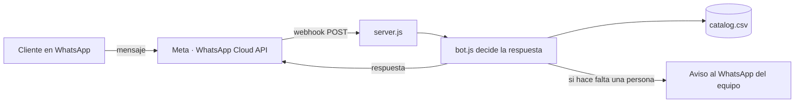

# WhatsApp Catalog Bot

Bot de WhatsApp para tiendas: responde precios, stock, envíos y formas de pago a partir de un catálogo, y le pasa la charla a una persona del equipo cuando no sabe la respuesta.

*WhatsApp bot for online stores: answers prices, stock, shipping and payment questions from a CSV catalog, and hands the chat over to a human when it can't answer. Node.js + Express + WhatsApp Cloud API.*

## Cómo funciona



1. Meta manda cada mensaje nuevo al endpoint `/webhook`.
2. `bot.js` busca si el mensaje nombra un producto del catálogo. Si lo encuentra, responde precio de lista, precio en efectivo y stock.
3. Si pregunta por envíos, horarios o pagos, responde con los datos del negocio.
4. Si es un reclamo o algo que no entiende, **no inventa**: le avisa al equipo por WhatsApp con el mensaje del cliente.

## Ejemplo

```
Cliente: Hola! cuánto sale el club de nuit intense man?
Bot:     Armaf Club de Nuit Intense Man 100 ml: $105.000 en hasta 6 cuotas sin interés
         o $79.000 en efectivo o transferencia.
         ¿Te lo separo?
```

## Probarlo

Requiere Node.js 20 o superior.

```bash
npm install
npm test          # 7 pruebas del bot, sin conectarse a WhatsApp
cp .env.example .env
npm start         # levanta el servidor en http://localhost:3000
```

Para conectarlo a un número real hace falta una app de Meta con WhatsApp Cloud API: el token y el ID del número van en `.env`, y la URL pública del servidor + `/webhook` se carga en la configuración del webhook de Meta.

## Estructura

| Archivo | Qué hace |
| --- | --- |
| `src/server.js` | Servidor Express: verifica el webhook, recibe mensajes y responde |
| `src/bot.js` | Decide la respuesta y si hay que derivar a una persona |
| `src/catalog.js` | Lee el CSV y encuentra productos aunque escriban sin tildes o en mayúsculas |
| `src/whatsapp.js` | Lee el formato de Meta y manda mensajes por la Graph API |
| `data/catalog.csv` | El catálogo: nombre, marca, tamaño, precio, precio en efectivo y stock |
| `test/` | Pruebas con el test runner nativo de Node |

## Contexto

Es una versión chica y abierta de lo que hago en [Botto](https://botto.ar), donde armo asistentes de WhatsApp e Instagram para negocios. Ahí el motor corre en n8n, usa IA (Claude) para lo que no son preguntas fijas y las charlas se ven en un panel de Chatwoot. Podés probarlo en [botto.ar/demo](https://botto.ar/demo).
